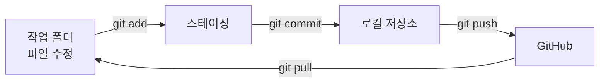

# 17. git·GitHub·Actions

## git은 "저장 시점 기록기"

**git**은 파일의 변경 이력을 저장하는 프로그램입니다. 원하는 시점을 **커밋(commit)**으로 남겨 두면 언제든 그때로 돌아가거나 무엇이 바뀌었는지 비교할 수 있습니다. **GitHub**은 git 저장소를 인터넷에 올려 두고 함께 작업하는 서비스입니다.

설치: <https://git-scm.com/> (Windows는 Git for Windows)

## 처음 한 번: 사용자 정보

```powershell
git config --global user.name "내 이름"
git config --global user.email "me@example.com"
```

!!! warning "커밋에는 이메일이 기록됩니다"
    커밋마다 위 이메일이 함께 저장되고, **공개 저장소에서는 누구나 볼 수 있습니다.** 회사·개인 이메일을 드러내고 싶지 않다면 GitHub의 **Settings → Emails**에서 제공하는 `숫자+아이디@users.noreply.github.com` 주소를 쓰세요. 특정 저장소에서만 바꾸려면 그 폴더에서 `--global` 없이 설정합니다.
    ```powershell
    git config user.email "12345678+myid@users.noreply.github.com"
    ```

## 기본 흐름

```powershell
cd D:\study\myapp
git init                      # 1) 이 폴더를 git 저장소로 (처음 한 번)
git status                    # 2) 무엇이 바뀌었는지 보기
git add main.py               # 3) 커밋할 파일 고르기 (스테이징)
git commit -m "인사 기능 추가"  # 4) 기록 남기기
git log --oneline             # 5) 기록 보기
git diff                      # 아직 add 하지 않은 변경 내용 보기
```



## .gitignore

저장소에 **올리지 말아야 할 파일**을 적습니다.

```text title=".gitignore"
.venv/
__pycache__/
.env
*.log
```

`.env`처럼 시크릿이 들어 있는 파일은 **처음 커밋하기 전에** `.gitignore`에 넣으세요. 이미 커밋한 파일은 `.gitignore`에 추가해도 기록에서 사라지지 않습니다.

## GitHub에 올리기

1. GitHub에서 **New repository**로 빈 저장소를 만듭니다. (공개 Public / 비공개 Private 선택)
2. 안내에 나오는 명령을 실행합니다.

```powershell
git remote add origin https://github.com/내아이디/myapp.git
git branch -M main
git push -u origin main
```

이후에는 커밋하고 `git push`만 하면 됩니다. 다른 PC에서 받을 때는 `git clone 주소`, 최신 내용을 가져올 때는 `git pull`을 씁니다.

!!! tip "브랜치"
    `git switch -c 새기능`으로 브랜치를 만들어 작업하고, GitHub에서 **Pull Request**로 검토받은 뒤 `main`에 합치는 것이 일반적인 협업 방식입니다.

## GitHub Actions 로 예약 실행

**GitHub Actions**는 GitHub 서버에서 정해진 때에 명령을 실행해 주는 기능입니다. 저장소의 `.github/workflows/` 폴더에 YAML 파일을 두면 동작합니다.

```yaml title=".github/workflows/daily.yml"
name: daily-report

on:
  schedule:
    - cron: "0 22 * * *"      # 매일 22:00 UTC = 한국 시간 다음 날 07:00
  workflow_dispatch:          # Actions 화면에서 수동 실행 버튼

permissions:
  contents: read              # 필요한 최소 권한만

jobs:
  run:
    runs-on: ubuntu-latest
    steps:
      - uses: actions/checkout@v4
      - uses: actions/setup-python@v5
        with:
          python-version: "3.12"
      - run: python -m pip install -r requirements.txt
      - run: python -m unittest discover -s tests
      - run: python main.py
        env:
          API_KEY: ${{ secrets.API_KEY }}   # Settings → Secrets 에 등록한 값
```

| cron 칸 | 뜻 | 예 |
|---|---|---|
| 1 | 분 (0–59) | `0` |
| 2 | 시 (0–23, **UTC**) | `22` |
| 3 | 일 | `*` (매일) |
| 4 | 월 | `*` |
| 5 | 요일 (0=일) | `1-5` (월–금) |

!!! note "예약 실행의 특성"
    - cron 시각은 **UTC 기준**입니다. 한국 시간(KST)에서 9시간을 빼서 적습니다.
    - GitHub 공식 문서에 따르면 예약 실행은 서버가 바쁘면 **늦게 시작되거나 건너뛰어질 수 있고**, 공개 저장소에서 오랫동안 활동이 없으면 예약 워크플로가 자동으로 꺼질 수 있습니다. 정확한 시각이 중요한 일에는 맞지 않습니다.
    - 사용량 한도와 요금 정책은 바뀔 수 있으니 [GitHub Actions 문서](https://docs.github.com/actions)에서 확인하세요.

이 위키도 GitHub Actions로 배포됩니다. 저장소의 `.github/workflows/deploy.yml`은 `main`에 push될 때마다 **예제 테스트 → 위키 빌드 → GitHub Pages 배포**를 실행합니다.

## 연습문제

1. 새 폴더에서 `git init` 후 `hello.py`를 만들어 첫 커밋을 남기고, `git log --oneline`으로 확인하세요.
2. 평일(월–금) 한국 시간 오전 8시 30분에 실행되는 cron 식을 쓰세요.
3. `.env`를 실수로 커밋하고 push했습니다. 무엇을 해야 할까요?

??? success "해답"
    1. ```powershell
       mkdir D:\study\git-test; cd D:\study\git-test
       git init
       Set-Content hello.py 'print("hi")' -Encoding utf8
       git add hello.py
       git commit -m "첫 커밋"
       git log --oneline
       ```
    2. 한국 08:30 = UTC 23:30 **전날**입니다. 한국의 월–금 아침은 UTC로 일–목 밤이므로 `30 23 * * 0-4`.
    3. **가장 먼저 그 안에 있던 비밀번호·키를 모두 폐기하고 새로 발급합니다.** 그다음 `.env`를 `.gitignore`에 추가하고 `git rm --cached .env`로 추적을 멈춘 뒤 커밋합니다. 과거 기록에서도 지우려면 `git filter-repo` 같은 도구가 필요하지만, 이미 노출된 값은 되돌릴 수 없으므로 폐기가 핵심입니다.
