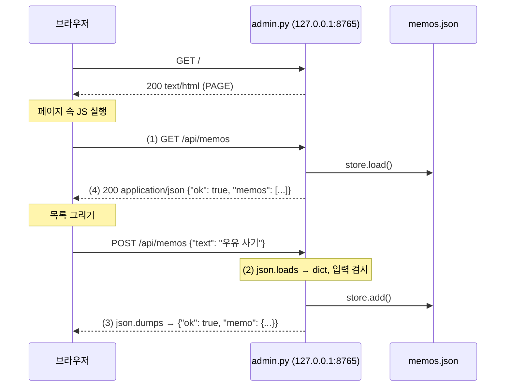

# 사례 학습: `python -m 패키지.모듈`은 어떻게 동작하나

어떤 프로젝트의 README에 이런 실행 방법이 적혀 있다고 합시다.

```powershell
python -m myapp.admin
```

명령 한 줄로 브라우저에 관리 화면이 뜹니다. 이 장에서는 이 명령이 **무슨 일을 하는지** 처음부터 따라가 봅니다. 실제 프로젝트 코드 대신, 같은 원리로 동작하는 작은 학습용 메모 앱 `memoapp`을 만들어 살펴봅니다.

```text
examples/case_python_m/        ← ★ 여기(패키지의 부모 폴더)에서 실행합니다
├── greet.py                   ← __name__ 실험용
├── use_greet.py
└── memoapp/                   ← 패키지 (폴더)
    ├── __init__.py            ← 이 폴더를 패키지로 만듦
    ├── __main__.py            ← python -m memoapp 으로 실행되는 파일
    ├── store.py               ← 메모 저장 (JSON 파일)
    └── admin.py               ← python -m memoapp.admin 으로 실행되는 웹 서버
```

```powershell
cd python-wiki\examples\case_python_m
python -m memoapp              # 메모 목록 출력
python -m memoapp.admin        # 관리 화면 서버 시작 → http://127.0.0.1:8765/
```

## 1단계: `python 파일.py` 와 `python -m 모듈` 의 차이

| | `python memoapp\admin.py` | `python -m memoapp.admin` |
|---|---|---|
| 무엇을 주나 | **파일 경로** | **모듈 이름** (점으로 구분, `.py` 없음) |
| 찾는 방법 | 그 경로의 파일을 바로 실행 | `sys.path`에서 `memoapp` 패키지를 찾고 그 안의 `admin` 모듈을 실행 |
| `sys.path` 첫 칸 | 파일이 있는 폴더 (`memoapp\`) | **현재 폴더** (`case_python_m\`) |
| 패키지로 인식 | ❌ 그냥 파일 하나 | ✅ `memoapp` 패키지의 일부 |
| 상대 import (`from .store`) | ❌ 실패 | ✅ 동작 |

`python -m memoapp.admin`은 "**memoapp 패키지 안의 admin 모듈을 프로그램으로 실행하라**"는 뜻입니다. 앞에서 `python -m pip`, `python -m venv`, `python -m http.server`, `python -m unittest`를 썼는데, 모두 같은 원리입니다. 파이썬에 들어 있거나 설치된 모듈을 **이름으로** 찾아 실행한 것입니다.

### 그래서 어느 폴더에서 실행하느냐가 중요합니다

`-m`은 **현재 폴더**를 기준으로 패키지를 찾습니다. 따라서 `memoapp` 폴더가 **보이는 곳**(부모 폴더)에서 실행해야 합니다.

```powershell
cd examples\case_python_m          # ✅ 여기서 ls 하면 memoapp 폴더가 보임
python -m memoapp.admin

cd memoapp                         # ❌ 패키지 '안'으로 들어오면
python -m memoapp.admin            # No module named 'memoapp'
```

`ls`(또는 `dir`)를 했을 때 **패키지 폴더 이름이 목록에 보이는지** 확인하는 습관을 들이세요. [01장의 현재 폴더 이야기](01-setup.md#하위-폴더에서-실행하면-파일을-못-찾는-이유)와 같은 문제입니다.

## 2단계: 패키지 폴더와 `__init__.py`

```python title="memoapp/__init__.py"
--8<-- "examples/case_python_m/memoapp/__init__.py"
```

- `__init__.py`가 있는 폴더는 **일반 패키지**입니다. `import memoapp`을 하면 이 파일이 먼저 실행됩니다.
- 보통은 비워 두거나 버전 번호, 자주 쓰는 이름 정도만 둡니다.
- Python 3.3부터는 `__init__.py`가 없어도 '네임스페이스 패키지'로 import되긴 하지만, 일반 프로젝트에서는 **두는 것이 명확합니다.**

## 3단계: `__main__.py` — 패키지 자체를 실행할 때

`python -m memoapp`처럼 **패키지 이름만** 주면, 파이썬은 그 패키지 안의 `__main__.py`를 실행합니다.

```python title="memoapp/__main__.py"
--8<-- "examples/case_python_m/memoapp/__main__.py"
```

```text
> python -m memoapp
__name__ = '__main__', __package__ = 'memoapp'
메모 0개
관리 화면은: python -m memoapp.admin
```

`__package__`가 `'memoapp'`이라는 점이 중요합니다. 파이썬이 이 파일을 **memoapp 패키지의 일부로 알고 있다**는 뜻이고, 그래서 `from .store import ...` 같은 상대 import가 동작합니다.

| 명령 | 실행되는 파일 |
|---|---|
| `python -m memoapp` | `memoapp/__main__.py` |
| `python -m memoapp.admin` | `memoapp/admin.py` |

어느 경우든 파이썬은 먼저 `memoapp/__init__.py`를 실행해 패키지를 준비한 다음, 대상 모듈을 실행합니다.

## 4단계: `if __name__ == "__main__":`

모든 모듈에는 `__name__`이라는 변수가 자동으로 생깁니다.

- 그 파일을 **프로그램으로 직접 실행**하면 → `__name__`은 `"__main__"`
- 다른 파일에서 **import** 하면 → `__name__`은 모듈 이름 (`"greet"`, `"memoapp.admin"` 등)

```python title="greet.py"
--8<-- "examples/case_python_m/greet.py"
```

```python title="use_greet.py"
--8<-- "examples/case_python_m/use_greet.py"
```

=== "python greet.py"

    ```text
    greet.py 의 __name__ = '__main__'
    안녕하세요, 직접 실행님
    ```

=== "python use_greet.py"

    ```text
    greet.py 의 __name__ = 'greet'
    안녕하세요, import 한 쪽님
    use_greet.py 의 __name__ = '__main__'
    ```

`import greet`를 하면 `greet.py`가 **맨 위부터 실행**되지만, `if __name__ == "__main__":` 아래는 건너뜁니다. 그래서 이 줄은 "**직접 실행했을 때만 프로그램을 시작하고, import될 때는 함수·클래스만 제공하라**"는 관용구입니다.

`admin.py` 맨 아래도 마찬가지입니다.

```python
if __name__ == "__main__":
    sys.exit(main())
```

- `python -m memoapp.admin`으로 실행하면 `__name__ == "__main__"`이므로 `main()`이 호출되어 서버가 뜹니다.
- 테스트 코드가 `from memoapp.admin import create_server`로 import하면 서버가 저절로 뜨지 않습니다. 그래서 테스트에서 원하는 포트로 직접 띄워 검사할 수 있습니다.
- `main()`이 돌려준 숫자는 `sys.exit()`를 통해 **종료 코드**가 됩니다. 0은 성공, 그 외는 실패를 뜻하며, GitHub Actions 같은 도구가 이 값으로 성공 여부를 판단합니다.

## 5단계: 상대 import

```python
from .store import MemoStore, default_path
```

앞의 점(`.`)은 "**나와 같은 패키지 안의**"라는 뜻입니다. `..`은 한 단계 위 패키지입니다.

| 쓰는 법 | 뜻 |
|---|---|
| `from .store import MemoStore` | 같은 패키지(memoapp)의 store 모듈 |
| `from . import store` | 같은 패키지에서 store 모듈 자체 |
| `from memoapp.store import MemoStore` | 절대 import — 같은 결과 |

상대 import는 **파이썬이 현재 모듈이 어느 패키지에 속하는지 알 때만** 동작합니다. 파일 경로로 실행하면 그 정보가 없어서 실패합니다.

```text
> python memoapp\admin.py
Traceback (most recent call last):
  File "...\memoapp\admin.py", line 15, in <module>
    from .store import MemoStore, default_path
ImportError: attempted relative import with no known parent package
```

이 오류가 보이면 **"`-m`으로, 패키지의 부모 폴더에서 실행하라"**는 신호입니다.

## 6단계: 데이터 파일 위치 — 현재 폴더에 휘둘리지 않기

```python title="memoapp/store.py"
--8<-- "examples/case_python_m/memoapp/store.py"
```

`default_path()`는 `Path(__file__).resolve().parent.parent`, 즉 **store.py 위치 기준**으로 데이터 파일을 정합니다. `-m`으로 실행하려면 부모 폴더에 있어야 하지만, 데이터 파일 경로는 현재 폴더와 상관없이 늘 같은 곳을 가리킵니다. 환경변수 `MEMOAPP_DATA`로 바꿀 수도 있게 해 두어 테스트에서는 임시 폴더를 씁니다.

## 7단계: `http.server`로 로컬 웹 서버 띄우기

```python title="memoapp/admin.py"
--8<-- "examples/case_python_m/memoapp/admin.py"
```

`main()`이 하는 일을 순서대로 보면:

1. `argparse`로 `--port` 옵션을 읽습니다. (기본 8765)
2. `create_server()`가 `ThreadingHTTPServer(("127.0.0.1", port), ...)`를 만듭니다. 이 순간 운영체제에 "127.0.0.1의 8765번 포트로 오는 연결은 내가 받겠다"고 등록됩니다.
3. 접속 주소를 출력합니다.
4. `serve_forever()`가 요청을 **끝없이 기다리며** 하나씩 처리합니다. 그래서 명령이 끝나지 않고 창이 "멈춘 것처럼" 보이는 것이 정상입니다.
5. ++ctrl+c++를 누르면 `KeyboardInterrupt`가 발생하고, `finally`에서 서버를 닫습니다.

!!! note "포트를 이미 쓰고 있다면"
    이 예제는 같은 포트로 서버를 두 개 띄우면 `OSError: [WinError 10048]`(Address already in use)을 내고 멈춥니다. 먼저 띄운 창을 ++ctrl+c++로 끄거나 `--port 8766`처럼 다른 번호를 쓰세요. `--port 0`을 주면 운영체제가 비어 있는 포트를 골라 줍니다.

!!! warning "Windows에서 포트가 '조용히 겹치는' 문제"
    `HTTPServer`·`ThreadingHTTPServer`는 기본으로 `allow_reuse_address = True`(소켓 옵션 `SO_REUSEADDR`)를 켭니다. 리눅스·macOS에서는 재시작을 빠르게 하려는 옵션이지만, **Windows에서는 이미 다른 프로그램이 쓰고 있는 포트에도 오류 없이 바인딩됩니다.** 그러면 서버가 정상적으로 뜬 것처럼 보이는데, 브라우저는 먼저 떠 있던 **다른 서버**의 화면을 보여 줄 수 있습니다. (이 위키를 만들면서 실제로 겪은 일입니다.)
    그래서 예제의 `LocalServer`는 Windows에서 이 옵션을 끕니다.
    ```python
    class LocalServer(ThreadingHTTPServer):
        allow_reuse_address = sys.platform != "win32"
    ```

### 127.0.0.1 의 의미

`127.0.0.1`(= `localhost`)은 **"이 컴퓨터 자신"**을 가리키는 주소입니다. 서버를 여기에만 바인딩하면:

- 같은 PC의 브라우저는 접속할 수 있습니다.
- 같은 와이파이의 다른 PC나 인터넷에서는 **접속할 수 없습니다.**

메일 주소 같은 개인정보를 다루는 관리 화면을 로컬 전용으로 만들 때 쓰는 기본 장치입니다. 다만 같은 PC에서 열린 **다른 웹사이트의 스크립트**가 로컬 서버에 요청을 보내는 공격도 있기 때문에, 예제는 `Host` 헤더가 `127.0.0.1:포트` 또는 `localhost:포트`일 때만 응답하고, POST는 `Content-Type: application/json`만 받습니다. 실제 도구라면 여기에 무작위 세션 토큰 확인 등을 더하는 것이 좋습니다.

## 8단계: 브라우저와 서버가 JSON을 주고받는 흐름

관리 화면은 **처음 한 번 HTML 페이지를 받고**, 그 뒤에는 페이지 안의 자바스크립트가 **JSON으로만** 서버와 대화합니다.



| 단계 | 어디서 | 하는 일 |
|---|---|---|
| (1) | 브라우저 JS | `fetch("/api/memos")`로 요청 |
| (2) | 서버 `do_POST` | 요청 본문(JSON 문자열)을 `json.loads`로 dict로 |
| (3) | 서버 `_json` | 결과 dict를 `json.dumps`로 문자열로, `Content-Type: application/json`으로 응답 |
| (4) | 브라우저 JS | `res.json()`으로 받아 화면에 표시 |

브라우저의 **개발자 도구(F12) → 네트워크** 탭을 열고 메모를 추가해 보세요. `/api/memos` 요청의 **페이로드**와 **응답**에서 JSON이 오가는 모습을 직접 볼 수 있습니다.

!!! tip "직접 요청 보내 보기"
    서버가 떠 있는 상태에서 **새 PowerShell 창**을 열어:
    ```powershell
    Invoke-RestMethod http://127.0.0.1:8765/api/memos
    Invoke-RestMethod http://127.0.0.1:8765/api/memos -Method Post -ContentType "application/json" -Body '{"text": "PowerShell에서 추가"}'
    ```
    브라우저를 새로 고치면 방금 추가한 메모가 보입니다. 브라우저든 PowerShell이든 **같은 HTTP + JSON 규칙**으로 대화한다는 것을 알 수 있습니다.

### 입력 검증과 XSS

- 서버는 빈 메모·200자 초과·JSON이 아닌 본문·너무 큰 요청을 **400·413·415 오류로 거절**합니다. 화면(JS)에서 막더라도, 요청은 PowerShell처럼 화면 밖에서도 보낼 수 있으므로 **검증은 서버에서 해야 합니다.**
- 화면에 메모를 표시할 때 `innerHTML` 대신 `textContent`를 써서, 메모 내용에 `<script>`가 있어도 실행되지 않고 글자로만 보이게 합니다.
- `log_message`를 바꿔 **요청 본문(개인정보)이 로그에 남지 않게** 했습니다.

## 정리: `python -m memoapp.admin`을 입력하면

1. 파이썬이 **현재 폴더**를 `sys.path` 맨 앞에 넣습니다.
2. `sys.path`에서 `memoapp` 폴더를 찾고, `memoapp/__init__.py`를 실행해 패키지를 준비합니다.
3. `memoapp/admin.py`를 `__name__ = "__main__"`, `__package__ = "memoapp"`으로 실행합니다.
4. `from .store import ...` 상대 import가 `memoapp/store.py`를 불러옵니다.
5. 맨 아래 `if __name__ == "__main__":`이 참이므로 `main()`이 실행됩니다.
6. `main()`이 127.0.0.1:8765에 HTTP 서버를 열고 `serve_forever()`로 요청을 기다립니다.
7. 브라우저가 `GET /`로 HTML을 받고, 이후 `fetch`로 `/api/...`와 **JSON**을 주고받습니다.
8. ++ctrl+c++로 끝내면 서버를 닫고 종료 코드 0을 돌려줍니다.

## 연습문제

1. `case_python_m` 폴더에서 `python -m memoapp`, `python memoapp\__main__.py`를 각각 실행해 보고 결과가 왜 다른지 설명하세요.
2. `python -m memoapp.admin --port 9000`으로 띄운 뒤 브라우저에서 접속해 메모를 두 개 추가하고, `memos.json` 파일 내용을 확인하세요.
3. `admin.py`에 `GET /api/count` 경로를 추가해 `{"ok": true, "count": 메모개수}`를 돌려주세요.
4. `memoapp/__main__.py`의 상대 import를 절대 import(`from memoapp.store import ...`)로 바꾸면 `python memoapp\__main__.py`가 동작할까요?

??? success "해답"
    1. `python -m memoapp`은 패키지의 `__main__.py`를 **패키지의 일부로** 실행하므로 `__package__ = 'memoapp'`이고 상대 import가 동작합니다. `python memoapp\__main__.py`는 그냥 파일 하나를 실행하므로 `__package__`가 비어 있고, `from .store import ...`에서 `ImportError: attempted relative import with no known parent package`가 납니다.
    2. `examples\case_python_m\memos.json`에 `[{"text": "...", "created": "..."}]` 형태로 저장됩니다.
    3. `do_GET`에 추가합니다.
       ```python
       if self.path == "/api/count":
           return self._json(HTTPStatus.OK, {"ok": True, "count": len(store.load())})
       ```
       확인: `Invoke-RestMethod http://127.0.0.1:9000/api/count`
    4. **여전히 실패합니다.** 파일 경로로 실행하면 `sys.path` 첫 칸이 `memoapp` 폴더 **안**이 되므로, 그 안에서는 `memoapp` 패키지를 찾을 수 없어 `ModuleNotFoundError: No module named 'memoapp'`가 납니다. 패키지 안의 파일은 **부모 폴더에서 `-m`으로** 실행하는 것이 정석입니다.

## 더 읽어 보기

- [Python 공식 문서: 명령줄 `-m` 옵션](https://docs.python.org/ko/3/using/cmdline.html#cmdoption-m)
- [Python 공식 문서: `__main__` — 최상위 코드 환경](https://docs.python.org/ko/3/library/__main__.html)
- [Python 공식 튜토리얼: 모듈과 패키지](https://docs.python.org/ko/3/tutorial/modules.html)
- [Python 공식 문서: `http.server`](https://docs.python.org/ko/3/library/http.server.html)
